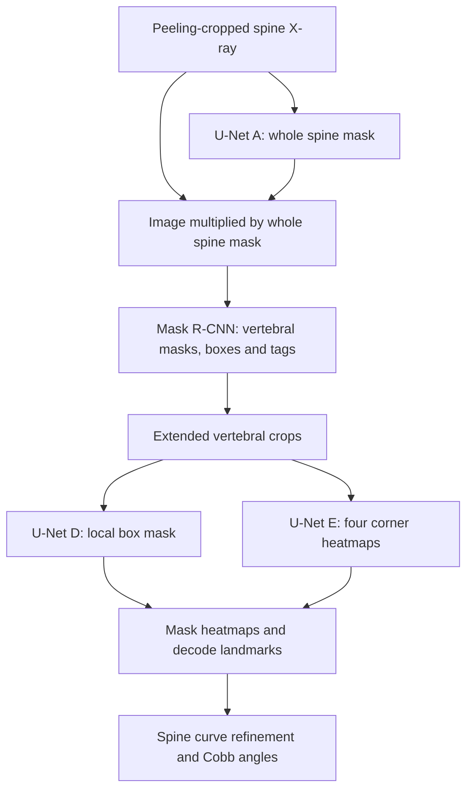

# AASCE2019: Coarse-to-Fine Spinal Landmark Detection

[Published paper](https://doi.org/10.1007/978-3-030-39752-4_12) ·
[English training guide](docs/TRAINING.md) · [中文训练说明](TRAINING.md) ·
[Citation metadata](CITATION.cff)

Code associated with **A Coarse-to-Fine Deep Heatmap Regression Method for
Adolescent Idiopathic Scoliosis Assessment**, by Zhusi Zhong, Jie Li, Zhenxi Zhang,
Zhicheng Jiao, and Xinbo Gao. CSI 2019, LNCS 11963, pp. 101–106 (2020).
[Paper / DOI](https://doi.org/10.1007/978-3-030-39752-4_12).
Published online on **February 1, 2020**, in the proceedings of **CSI 2019**,
a MICCAI workshop. The DOI links to the publisher's version.

This repository contains the historical inference and peeling-crop pipeline,
plus a PyTorch training implementation for **17 vertebrae / 68 corner landmarks**
on frontal spine X-rays. The five heatmap models use **U-Net** by default.
Training supports the native AASCE/BoostNet folder layout, MATLAB point labels,
normalized CSV labels, held-out validation, checkpoints, and resumable runs.

## Method overview



U-Nets A, B and C also drive the iterative **peeling crop** preprocessing.
The global and local networks are trained independently. The heatmap loss and
SGD defaults are adapted from the companion
[dental landmark implementation](https://github.com/zzs95/dental-landmark-localization).

## Models and training targets

All five heatmap networks default to the existing **U-Net**, with grayscale input
and a channel-wise softmax. Background is always the last channel.

| Paper model | `--stage` | Output | Default height × width |
| --- | --- | --- | --- |
| A | `wsm` | Whole Spine Mask + background | 690 × 255 |
| B | `tsm` | Target Spine Mask + background | 688 × 254 |
| C | `boxes` | 17 vertebral quadrilaterals + background | 806 × 298 |
| Global detector | `maskrcnn` | Instance masks, bounding boxes, tags 1–17 | 806 × 298 |
| D | `local-box` | Local vertebral mask + background | 255 × 255 |
| E | `local-points` | Four corner heatmaps + background | 255 × 255 |

Train the models separately. A frozen A prediction masks the detector input in
both training and validation. D/E sample the same type of extended ground-truth
bounding-box patches, with training-only center jitter. Peeling crop and the
polynomial curve refinement are inference procedures, not additional networks.

The paper does **not** specify a complete optimization recipe or numerical
WSM/TSM target construction. The continuous spine envelope, dilation and blur
implemented here are configurable reconstructions. The optimizer/loss settings
are adaptations of dental training, not recovered AASCE experiment settings.
This update does not claim reproduction of the paper's reported SMAPE.

## Installation and data

Use a new Python environment (tested: Windows, Python 3.12, PyTorch 2.6.0,
torchvision 0.21.0). For a CPU environment:

```powershell
git clone https://github.com/zzs95/AASCE2019_code.git
cd AASCE2019_code
python -m venv .venv
.\.venv\Scripts\Activate.ps1
python -m pip install torch==2.6.0 torchvision==0.21.0 --index-url https://download.pytorch.org/whl/cpu
python -m pip install -r requirements-training.txt
```

For GPU training, install the matching CUDA wheels for this PyTorch/torchvision
pair before installing the requirements. These modern training dependencies are
separate from the original MXNet/GluonCV inference environment.

The native dataset layout is supported directly; no copying or renaming is needed:

```text
boostnet_labeldata/
  data/training/*.jpg
  data/test/*.jpg
  labels/training/*.jpg.mat
  labels/training/filenames.csv
  labels/training/landmarks.csv
  labels/training/angles.csv
  labels/test/...
```

Labels: MATLAB variable `p2` or numeric `.npy`, shaped `(68,2)`, `(2,68)` or
`(17,4,2)`. Coordinates are pixel **(x,y)**. The 17 vertebrae must run from superior
to inferior; four corners per vertebra are **TL, TR, BL, BR**. Default coordinates
are zero-based, matching the legacy loader. Add `--coordinate-base 1` for actual
MATLAB one-based coordinates. `--label-format csv` instead pairs `filenames.csv`
with `landmarks.csv`: 136 columns, all 68 normalized x coordinates followed by
all 68 normalized y coordinates. They are scaled by each image's width/height;
`--coordinate-base` applies only to pixel MAT/NPY labels. `angles.csv` is retained
as metadata and is not a heatmap training target. Auto mode prefers MAT/NPY,
falling back to CSV when pixel labels are absent.
Both `image.jpg.mat` and `image.mat` naming are recognized, but ambiguous labels
are rejected. Split image IDs and exact image-file hashes must not overlap.
Split before extracting local patches, at the patient level where applicable.

With `--data-root`, validation is held out from **training** by filename case
groups (default 20% of groups, seed 2019). Related A/B/... AP views, lowercase
names and `(2)` suffixes stay together. Coronal images from the same dated batch
are conservatively grouped together. These are filename-derived groups, not
verified patient identities. The original `data/test` is not used for model
selection. Alternatively, `--val-split validation` selects a separate native
validation split. Legacy `<split>/images` + `<split>/labels` remains supported
with `--train-dir` / `--val-dir`; native `data/<split>` paths also work there.

Every run checks annotations before starting workers. Default policy is to stop
on invalid samples and write `data_audit.json`. Use **`--invalid-samples skip`**
to explicitly exclude them, with reasons recorded in the audit. Coordinates are
never silently clipped, reordered or truncated. Nonmonotonic vertebral centers,
out-of-bounds points, degenerate quadrilaterals and unsupported point counts are
rejected. Historical 76/84/56-point challenge annotations are not converted to 68.

## Train

From the repository directory, set the dataset root and train each stage:

```powershell
$dataRoot = "D:/datasets/boostnet_labeldata"
python train.py --stage wsm --data-root "$dataRoot" --invalid-samples skip --output-dir saved_model/wsm
python train.py --stage tsm --data-root "$dataRoot" --invalid-samples skip --output-dir saved_model/tsm
python train.py --stage boxes --data-root "$dataRoot" --invalid-samples skip --output-dir saved_model/boxes
python train.py --stage maskrcnn --data-root "$dataRoot" --invalid-samples skip --wsm-checkpoint saved_model/wsm/best_weights.pth --output-dir saved_model/maskrcnn
python train.py --stage local-box --data-root "$dataRoot" --invalid-samples skip --output-dir saved_model/local-box
python train.py --stage local-points --data-root "$dataRoot" --invalid-samples skip --output-dir saved_model/local-points
```

Inspect the split without constructing a model:

```powershell
python train.py --stage wsm --data-root "$dataRoot" --invalid-samples skip --check-data --output-dir saved_model/data-check
```

Default device is CUDA if available, otherwise CPU. Use `--device cpu` explicitly
when needed. `--pretrained-detector` opts into downloading COCO initialization;
otherwise the detector starts from random weights without downloading anything.
Use `python train.py --help` for all settings. See the
[English training guide](docs/TRAINING.md) or [中文训练说明](TRAINING.md) for
resume commands, parameter provenance and compatibility notes.

Each run writes `last.pth` (resume), `best.pth` (best full checkpoint),
`best_weights.pth` (raw state dict), `config.json`, `split.json`, and
`history.jsonl`, plus `data_audit.json`. Model selection uses held-out heatmap
loss or detector instance mask IoU; detector IoU is a diagnostic, not COCO AP or
Cobb-angle SMAPE. Obtain the dataset separately; model weights and patient data
are not bundled with the training implementation.

## Legacy inference and pretrained weights

The original `main.py`, `Peeling_crop.py`, and `stage2_pred_maskrcnn.py` are retained.
They contain historical paths, CUDA assumptions and legacy dependencies, and are
not the new training entry point. The original dependency list is preserved in
[requirements-legacy.txt](requirements-legacy.txt).

U-Net raw weights retain the original parameter names and output-channel layout.
The original inference script instantiates **ResUNet for B**: either train B with
`--arch resunet` for that script, or change its B model to `UNet(1, 2)` before
loading the default new U-Net B weights. Update its hard-coded checkpoint paths.

The new detector uses **torchvision Mask R-CNN ResNet50-FPN**, whereas the original
uses GluonCV/MXNet. Their `.pth` / `.params` weights are **not interchangeable**.
[predict_detector.py](predict_detector.py) provides an adapter for the new
detector; integration into the legacy script is described in the training guide.

Original pretrained-model link (preserved, not revalidated by this update):
[Baidu Netdisk](https://pan.baidu.com/s/1Xo1Fm9C1JT3gS3O7KP8Gsw), code `ij8j`.

## Verification

```powershell
python -m unittest discover -s tests -v
```

Synthetic tests exercise target geometry/channel order, all five U-Net heads,
real Mask R-CNN forward/backward, Windows data workers, held-out validation,
checkpoint loading, native layout/CSV pairing, invalid-data audits, related-view
splitting and deterministic CPU resume. Eleven regression tests pass. All six
stages also completed one real training batch and one held-out validation batch
using the discovered dataset (CPU, reduced 96×64 input). This is a smoke test,
not a full experiment or a clinical performance measurement.

## Citation

If you use this code, please cite the published paper. GitHub's **Cite this
repository** feature uses [CITATION.cff](CITATION.cff), whose preferred citation
is the conference paper below.

```bibtex
@inproceedings{zhong2020coarse,
  title={A Coarse-to-Fine Deep Heatmap Regression Method for Adolescent Idiopathic Scoliosis Assessment},
  author={Zhong, Zhusi and Li, Jie and Zhang, Zhenxi and Jiao, Zhicheng and Gao, Xinbo},
  booktitle={Computational Methods and Clinical Applications for Spine Imaging},
  series={Lecture Notes in Computer Science},
  volume={11963},
  pages={101--106},
  year={2020},
  publisher={Springer, Cham},
  doi={10.1007/978-3-030-39752-4_12},
  url={https://doi.org/10.1007/978-3-030-39752-4_12}
}
```
